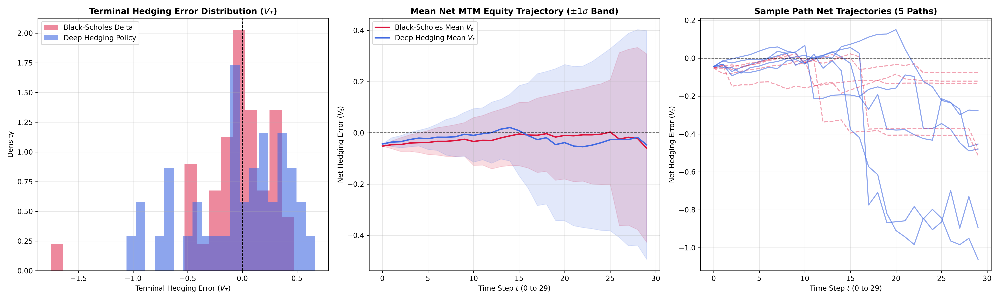

# cuda deep hedging

A CUDA implementation of neural option hedging (Deep Hedging) with Backpropagation Through Time (BPTT), proportional transaction costs, and a calibrated Black-Scholes baseline.

## Build & Run

```bash
# 1. fetch ^GSPC 1-hour bars and build chronological train/val/test splits
python scripts/fetch_data.py

# 2. configure Release (-O3) build, compile, and run unit tests
mkdir -p build && cd build
cmake ..
make -j
ctest --output-on-failure

# 3. train and evaluate on real S&P 500 (^GSPC) data
./deep_hedger

# optional: simulated GBM verification mode (10 bps cost, or 0 bps convergence check)
# ./deep_hedger --sim
# ./deep_hedger --sim --no-cost
# ./deep_hedger --sim --no-cost --lambda 0

# 4. compute metrics and generate plots
cd .. && python scripts/analysis.py
```

## Methodology & Quantitative Calibration

- **Equity Horizon & Volatility Calibration**: Uses 1-hour `^GSPC` bars (`5,007` candles over `720d`, observed mean `6.95` bars/trading day, modeled at `252 * 7 = 1,764` bars/year) over `num_steps = 30` (`29` intervals, `dt = 1 / 1764` yr, `T = 29 * dt = 0.01644` yr). Annualized volatility (`sigma = 0.1623`) is estimated strictly on the training split, and the ATM call (`S0 = K = 100`, `r = 0.04`, `10 bps` proportional fee) is priced via analytical Black-Scholes (`C0 = 0.8633`) with no empirical payoff leakage.
- **Leakage-Free Data Splits & Validation Checkpointing**: Raw prices are split chronologically *before* windowing with `>= 30`-bar purges between splits (`train`: `3,004` bars -> `2,975` rolling windows; `val`: `721` bars -> `692` rolling windows; `test`: `1,222` bars -> `40` strictly non-overlapping 30-bar horizons, inception spots `$6,413–$7,796`). Model weights are checkpointed by out-of-sample validation loss (`best_epoch = 110`, `best_val_loss = 0.2349`).
- **Unified Portfolio Accounting & Objective**: Both `compute_portfolio` and `compute_portfolio_trajectories` accrue risk-free cash over the `29` active intervals (`exp(r * T)` total), rebalance only at `t = 0 .. 28`, avoid rebalancing at expiry `t = 29`, liquidate incoming shares at `S_T` with consistent proportional fees, and mark inception `V_0 = -fee_0` at `t = 0`. Inputs are zero-centered and standardized (`normalize_state_features`) with prior-blended rolling volatility at `t = 0, 1`. Training uses AdamW (`weight_decay = 0.05`, `lr = 0.0005` cosine-annealed) minimizing a cash-invariant variance + smooth Rockafellar-Uryasev CVaR objective (`MeanVarCvar`: `Var(V_T) + 0.25 * smooth RU-CVaR@95%(-V_T)`). Optimal hedges are invariant to constant shifts in initial `option_price`, while the uncentered tail term penalizes transaction-cost bleed (note that uncentered `-V_T` under real-world $\mathbb{P}$ is not strictly drift-free; `--loss centered` and `--loss entropic` are also available via CLI flags).
- **CUDA & Build Hardening**: Warp reductions in `bptt_backward` execute uniformly across all 32 lanes with mask `0xFFFFFFFF` (`active ? local_val : 0.0f`), preventing tail-warp undefined behavior when `num_paths % 32 != 0`. `CMakeLists.txt` defaults to `Release` (`-O3`), and all constant-memory copies and kernel launches are guarded by `CUDA_CHECK` / `CUDA_CHECK_KERNEL()`.

## Performance Comparison

### 1. Simulated GBM Sanity Check (`./deep_hedger --sim`, `N = 8,192` Test Paths, `sigma = 0.20`, `T = 29/252` yr)

In a frictionless (`0 bps`) complete GBM market where analytical Black-Scholes is the exact ground truth, both strategies achieve near-zero mean PnL and the neural policy converges closely to the analytical Black-Scholes delta surface (`MAE = 0.0114–0.0136`, `RMSE = 0.0197–0.0225` across the 100×100 grid, with residuals concentrated at the `tau/T = 0.01` expiry discontinuity). Under `10 bps` proportional fees, the policy trades slightly higher tracking variance for lower transaction-cost bleed and lower `MeanVarCvar` loss.

| Cost Regime / Objective | Strategy | Mean PnL | Std Dev | Variance | Objective Loss | Surface MAE vs BS |
| :--- | :--- | :--- | :--- | :--- | :--- | :--- |
| **0 bps (`--no-cost --lambda 0`, pure Var)** | Black-Scholes Delta | -0.0017 | 0.4368 | 0.1908 | 0.1908 | — |
| **0 bps (`--no-cost --lambda 0`, pure Var)** | Deep Hedging Policy | -0.0021 | 0.4507 | 0.2032 | 0.2032 | 0.0114 |
| **0 bps (`--no-cost`, `MeanVarCvar`)** | Black-Scholes Delta | -0.0017 | 0.4368 | 0.1908 | 0.4493 | — |
| **0 bps (`--no-cost`, `MeanVarCvar`)** | Deep Hedging Policy | -0.0013 | 0.4558 | 0.2077 | 0.4564 | 0.0136 |
| **10 bps (`MeanVarCvar`)** | Black-Scholes Delta | -0.2799 | 0.4544 | 0.2065 | 0.5545 | — |
| **10 bps (`MeanVarCvar`)** | Deep Hedging Policy | -0.2659 | 0.4640 | 0.2153 | 0.5345 | — |

### 2. Out-of-Sample S&P 500 (`^GSPC`, `N = 40` Non-Overlapping Horizons, 10 bps Fee)

All PnL figures below are in normalized contract units (`S0 = K = 100`); `analysis.py` scales cumulative dollar PnL by each horizon's actual inception spot (`$6,413–$7,796`) per `1x` index unit.

| Metric | Black-Scholes Delta | Deep Hedging Policy |
| :--- | :--- | :--- |
| **Mean PnL** | -0.0595 | -0.0679 |
| **Median PnL** | -0.0485 | -0.0150 |
| **Std Dev** | 0.3677 | 0.3971 |
| **Variance** | 0.1352 | 0.1577 |
| **Sharpe Ratio** | -0.1617 | -0.1710 |
| **Sortino Ratio** | -0.1314 | -0.1414 |
| **Win Rate (%)** | 45.0000 | 47.5000 |
| **95% VaR** | -0.5129 | -0.9073 |
| **95% CVaR (Expected Shortfall)** | -1.1380 | -1.0186 |
| **99% VaR** | -1.2729 | -1.0408 |
| **99% CVaR** | -1.7513 | -1.1195 |
| **MeanVarCvar Loss** | 0.4198 | 0.4125 |
| **Mean MSE** | 0.1387 | 0.1623 |
| **Max Trajectory DD** | -0.0626 | -0.0813 |

**Small-Sample Sensitivity & Regime Analysis**:
- **Single-path dominance (`idx = 38`)**: With only `N = 40` independent test horizons, `99% CVaR` is a single horizon (`idx = 38`, spot `$7,600`, `-2.77%` drop where BS lost `-1.7513` vs Policy `-1.1194`) and `95% CVaR` averages just 2 horizons. Excluding that single outlier (`N = 39`), calibrated Black-Scholes Delta outperforms Deep Hedging across every summary metric:
  - **BS (`N = 39`, excl. `idx = 38`)**: `Mean = -0.0161`, `Std Dev = 0.2518`, `MSE = 0.0637`, `95% CVaR = -0.5185`.
  - **Policy (`N = 39`, excl. `idx = 38`)**: `Mean = -0.0410`, `Std Dev = 0.3642`, `MSE = 0.1343`, `95% CVaR = -0.9121`.
- **Rally vs. selloff regimes**: Because the neural policy smooths the near-expiry ATM gamma cliff to curb turnover, it under-hedges sharp upside rallies (`idx = 3, 4, 15, 39`, `+2.45%` to `+4.02%` moves, where Policy lost `-0.57` to `-0.92` vs BS `-0.25` to `-0.52`), leading to higher dispersion on up-horizons (`n = 23`: Policy `std = 0.4113` vs BS `0.2581`). Conversely, smoothing reduced whipsaw during the `idx = 38` drawdown (`n = 17` down-horizons: Policy `std = 0.3770` vs BS `0.4775`).
- **Cumulative PnL & drawdown context**: Across all `40` horizons, cumulative 1x-index-unit PnL was `-$162` for BS vs `-$173` for Policy. Policy stayed underwater across all 40 horizons (`min -$192`, `max -$11`), whereas BS climbed to `+$53` through horizon 36 before dropping on horizons 38–40 (`min -$162`). Comparing peak-to-trough drawdowns in isolation would be misleading because BS's larger peak-to-trough swing occurred from positive cumulative PnL.
- **Validation vs. test generalization**: On the `N = 692` held-out validation windows (`best_epoch = 110`), Deep Hedging achieved lower variance and loss than BS (`Mean = +0.0302` vs `-0.0657`, `Std Dev = 0.2924` vs `0.3423`, `Loss = 0.2349` vs `0.4012`), but the much smaller `N = 40` non-overlapping test set highlights finite-sample regime variance when training an MLP on ~`3,000` historical 1-hour bars.

## Visualizations

### Full Equity Curve Comparison


Shows actual per-horizon `^GSPC` inception spots (`$6,413–$7,796`) and cumulative 1x-index-unit PnL across the `40` non-overlapping horizons: Policy remained underwater throughout the early rally regime (`horizons 1–24`, trough `-$192`), while BS tracked closer to breakeven (`+$53` peak) until the late selloff (`idx = 38–39`).

### PnL Trajectory Analysis


Both strategies start at `V_0 = -fee_0 ≈ -0.05` (no artificial Day-0 gap) and remain centered near zero on average; the terminal histogram shows BS's tighter core distribution (`std = 0.2518` excluding `idx = 38`) alongside its single `-1.75` outlier at `idx = 38`.

### Hedging Surface 3D


Compares theoretical BS Delta against the trained MLP policy across moneyness and normalized time to expiry: the neural surface tracks BS monotonically while flattening the steep near-expiry (`tau/T -> 0`) ATM gamma cliff, explaining both lower turnover and rally under-hedging.

### Training & Validation Losses


Training loss decreases smoothly through epoch 2000 while validation loss reaches its minimum at `epoch 110` (`0.2349`) before flattening/drifting upward, illustrating why validation checkpointing is essential on finite historical market bars.
