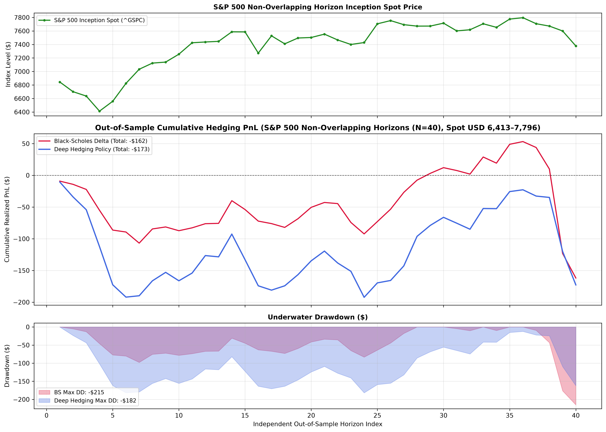
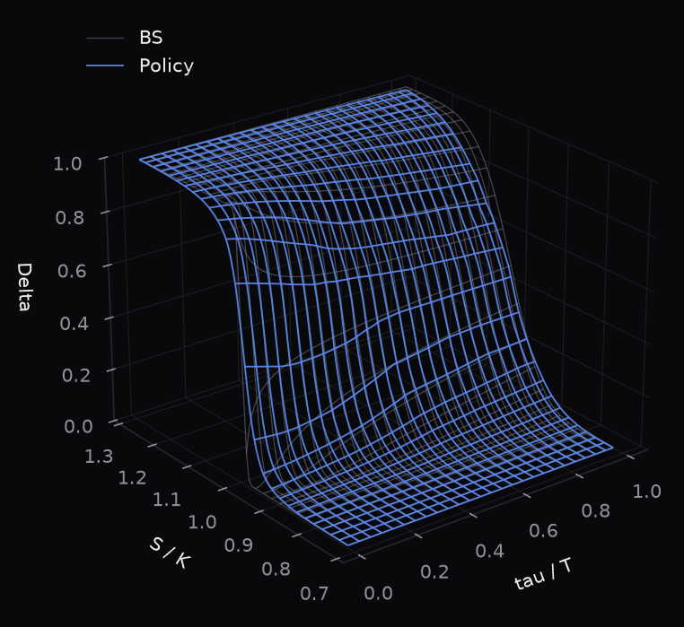
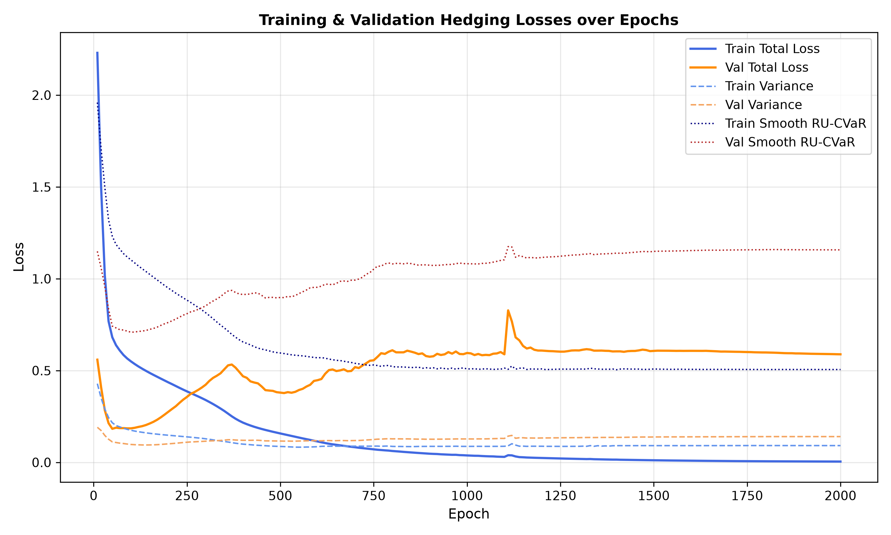

# cuda deep hedging

A CUDA implementation of neural option hedging (Deep Hedging) with Backpropagation Through Time (BPTT), proportional transaction costs, and a calibrated Black-Scholes baseline.

## Build & Run

```bash
# 1. fetch ^GSPC 1-hour bars and build chronological train/val/test splits
python scripts/fetch_data.py

# 2. configure Release (-O3) build, compile, and run unit tests
mkdir -p build && cd build
cmake ..
make -j
ctest --output-on-failure

# 3. train and evaluate on real S&P 500 (^GSPC) data
./deep_hedger

# optional: simulated GBM verification mode (10 bps cost, or add --no-cost)
# ./deep_hedger --sim

# 4. compute metrics and generate plots
cd .. && python scripts/analysis.py
```

## Methodology & Quantitative Calibration

- **Equity Horizon & Volatility Calibration**: Uses 1-hour `^GSPC` bars (`5,007` candles over `720d`, observed mean `6.95` bars/trading day, modeled at `252 * 7 = 1,764` bars/year) over `num_steps = 30` (`29` intervals, `dt = 1 / 1764` yr, `T = 29 * dt = 0.01644` yr). Annualized volatility (`sigma = 0.1623`) is estimated strictly on the training split, and the ATM call (`S0 = K = 100`, `r = 0.04`, `10 bps` proportional fee) is priced via analytical Black-Scholes (`C0 = 0.8633`) with no empirical payoff leakage.
- **Leakage-Free Data Splits & Validation Checkpointing**: Raw prices are split chronologically *before* windowing with `>= 30`-bar purges between splits (`train`: `3,004` bars -> `2,975` rolling windows; `val`: `721` bars -> `692` rolling windows; `test`: `1,222` bars -> `40` strictly non-overlapping 30-bar horizons, inception spots `$6,413–$7,796`). Model weights are checkpointed by out-of-sample validation loss (`best_epoch = 50`, `best_val_loss = 0.1827`).
- **Unified Portfolio Accounting & Objective**: Both `compute_portfolio` and `compute_portfolio_trajectories` accrue risk-free cash over the `29` active intervals (`exp(r * T)` total), rebalance only at `t = 0 .. 28`, avoid rebalancing at expiry `t = 29`, liquidate incoming shares at `S_T` with consistent proportional fees, and mark inception `V_0 = -fee_0` at `t = 0`. Inputs are zero-centered and standardized (`normalize_state_features`) with prior-blended rolling volatility at `t = 0, 1`. Training minimizes cash-invariant entropic risk (`gamma = 4.0`, `1/gamma * log E[exp(-gamma * V_T)]`) so gradients are invariant to initial cash shifts without exploiting equity drift (`--loss centered` is also supported for centered variance + smooth Rockafellar-Uryasev CVaR).
- **CUDA & Build Hardening**: Warp reductions in `bptt_backward` execute uniformly across all 32 lanes with mask `0xFFFFFFFF` (`active ? local_val : 0.0f`), preventing tail-warp undefined behavior when `num_paths % 32 != 0`. `CMakeLists.txt` defaults to `Release` (`-O3`), and all constant-memory copies and kernel launches are guarded by `CUDA_CHECK` / `CUDA_CHECK_KERNEL()`.

## Performance Comparison

### Out-of-Sample S&P 500 (`^GSPC`, `N = 40` Non-Overlapping Horizons, 10 bps Fee)

All PnL figures below are in normalized contract units (`S0 = K = 100`); `analysis.py` scales cumulative dollar PnL by each horizon's actual inception spot (`$6,413–$7,796`) per `1x` index unit.

| Metric | Black-Scholes Delta | Deep Hedging Policy |
| :--- | :--- | :--- |
| **Mean PnL** | -0.0595 | -0.0469 |
| **Median PnL** | -0.0485 | 0.0214 |
| **Std Dev** | 0.3677 | 0.4466 |
| **Variance** | 0.1352 | 0.1994 |
| **Sharpe Ratio** | -0.1617 | -0.1051 |
| **Sortino Ratio** | -0.1314 | -0.0868 |
| **Win Rate (%)** | 45.0000 | 52.5000 |
| **95% VaR** | -0.5129 | -0.8950 |
| **95% CVaR (Expected Shortfall)** | -1.1380 | -0.9976 |
| **99% VaR** | -1.2729 | -1.0116 |
| **99% CVaR** | -1.7513 | -1.0611 |
| **Entropic Risk ($\gamma = 4.0$)** | 0.8444 | 0.4626 |
| **Mean MSE** | 0.1387 | 0.2016 |
| **Max Trajectory DD** | -0.0626 | -0.0750 |

**Takeaway**: Under entropic risk ($\gamma = 4.0$), the learned policy smooths the near-expiry gamma cliff to reduce turnover and improve extreme left-tail outcomes (`95% CVaR` `-0.9976` vs `-1.1380`, `99% CVaR` `-1.0611` vs `-1.7513`, `Entropic Risk` `0.4626` vs `0.8444`), while calibrated Black-Scholes Delta retains lower overall tracking dispersion (`Std Dev` `0.3677` vs `0.4466`, `Mean MSE` `0.1387` vs `0.2016`) across the `40` non-overlapping horizons.

### Simulated GBM Verification (`./deep_hedger --sim`, `N = 8,192` Test Paths, `sigma = 0.20`, `T = 29/252` yr)

| Cost Regime | Strategy | Mean PnL | Std Dev | Variance | Entropic Risk ($\gamma = 4.0$) |
| :--- | :--- | :--- | :--- | :--- | :--- |
| **10 bps fee** | Black-Scholes Delta | -0.2799 | 0.4544 | 0.2065 | 1.2112 |
| **10 bps fee** | Deep Hedging Policy | -0.2435 | 0.5312 | 0.2822 | 0.8259 |

## Visualizations

### Full Equity Curve Comparison


### PnL Trajectory Analysis


### Hedging Surface 3D


### Training & Validation Losses

