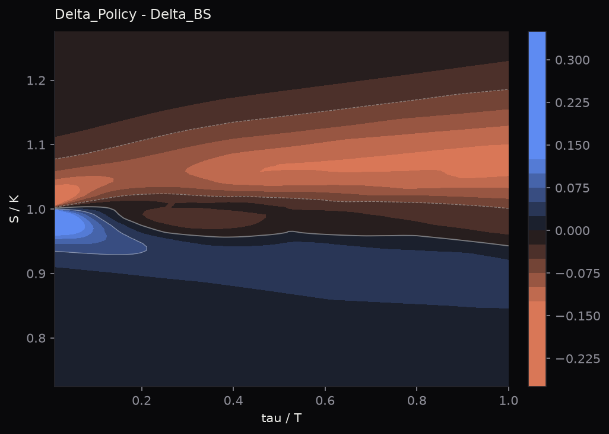
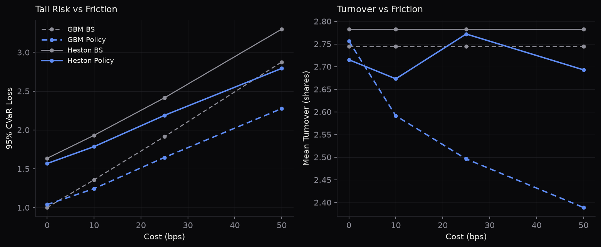

# cuda deep hedging

A CUDA C++17 implementation of Buehler et al. (2019) Deep Hedging for European call options under discrete rebalancing, proportional transaction costs, and stochastic volatility, compared against Black-Scholes delta hedging across 100,000 held-out simulated paths.

## Why

Black-Scholes delta hedging assumes continuous, frictionless trading and constant volatility. Under discrete daily rebalancing and proportional fees (`10–50 bps`), chasing every spot move erodes returns near the strike, while under correlated stochastic volatility (Heston), plug-in Black-Scholes misses the leverage-driven variance-return correlation (`rho = -0.70`). This project implements the GPU Monte Carlo path generator (GBM and Heston), forward policy evaluation, portfolio accounting, Backpropagation Through Time (BPTT) with full-mask warp reductions, and decoupled AdamW directly in custom CUDA kernels.

## How it works

Each run simulates `131,072` training paths, `32,768` validation paths, and `100,000` independent test paths over a 30-day call horizon (`S0 = 100`, `K = 100`, `r = 0.05`, `T = 30/252` years, `num_steps = 30`). Two market dynamics are supported:

- **GBM** (`sigma = 0.20`): analytical Black-Scholes call price (`C0`) and exact analytical Black-Scholes delta benchmark.
- **Heston** (`v0 = 0.04`, `theta = 0.04`, `kappa = 2.0`, `xi = 0.50`, `rho = -0.70`): Full Truncation Euler (`v_pos = max(v, 0)`) with `8` substeps per daily step, `C0` calibrated on an independent `200,000`-path risk-neutral Monte Carlo draw (`3.0186`), and plug-in Black-Scholes delta evaluated at instantaneous volatility `sqrt(v_pos)`.

The hedging policy is a 2-hidden-layer MLP (`5 -> 32 -> 32 -> 1` ReLU/sigmoid) taking normalized log-moneyness, prior delta, remaining time fraction `tau / T`, instantaneous volatility `sqrt(v_pos)`, and current `log(S_t / K)` slope context. Every step accrues cash across 29 rebalancing intervals (`r * dt`), charges proportional transaction fees (`--cost`), and settles remaining shares against the option payoff at expiry. Training minimizes terminal PnL variance plus `--lambda` weighted smooth Rockafellar-Uryasev 95% CVaR (`meanvar` default; `centered` and `entropic` also supported) using AdamW (`lr = 0.0020`, default weight decay `1e-4`; sweeps below run `400` epochs at `lr = 0.003`).

## Build and run

```bash
mkdir -p build && cd build
cmake ..
make -j
ctest --output-on-failure

# 100k OOS runs (defaults: 131072 train / 32768 val / 100000 test, 400 epochs)
./deep_hedger --model gbm --cost 0.0 --lambda 0.0 --wd 0.0 --lr 0.003
./deep_hedger --model gbm --cost 0.0025 --lambda 0.25 --wd 1e-4 --lr 0.003
./deep_hedger --model heston --cost 0.0025 --lambda 0.25 --wd 1e-4 --lr 0.003

# generate plots from results/
cd .. && python scripts/analysis.py
```

Supported CLI flags: `--model gbm|heston`, `--train-paths`, `--val-paths`, `--test-paths`, `--cost`, `--lambda`, `--epochs`, `--lr`, `--wd`, `--seed`, `--loss meanvar|centered|entropic`, `--gamma`.

## Performance

Measured on an NVIDIA GeForce RTX 3050 Laptop GPU (`4 GB` VRAM, SM 8.6, FP32 SoA layout):

- Peak device allocation delta (`cudaMemGetInfo`): `134.0 MB` for the full `131,072` train + `32,768` val + `100,000` test pipeline
- Training throughput (`cudaEventRecord`): `168.89–181.88 ms/epoch`, or `20.90–22.51 M paths*steps/sec`

## Out-of-sample results (`N = 100,000` test paths)

### GBM sweep (`400` epochs, `lr = 0.003`)

At `0 bps` (`--lambda 0 --wd 0`), the policy matches the analytical Black-Scholes delta grid with `Surface MAE = 0.0159` and `RMSE = 0.0251`. As transaction fees rise from `10` to `50 bps` (`--lambda 0.25 --wd 1e-4`), the policy reduces trading turnover and beats Black-Scholes on both 95% CVaR and mean PnL.

| Cost (bps) | Strategy | Mean PnL | Std Dev | Variance | 95% CVaR | Turnover (shares) |
| :--- | :--- | ---: | ---: | ---: | ---: | ---: |
| 0 | BS Delta | 0.0033 | 0.4340 | 0.1883 | 1.0004 | 2.7448 |
| 0 | Deep Hedging | 0.0030 | 0.4514 | 0.2037 | 1.0376 | 2.7567 |
| 10 | BS Delta | -0.2749 | 0.4498 | 0.2023 | 1.3569 | 2.7448 |
| 10 | Deep Hedging | -0.2596 | 0.4686 | 0.2196 | 1.2431 | 2.5915 |
| 25 | BS Delta | -0.6923 | 0.4936 | 0.2436 | 1.9136 | 2.7448 |
| 25 | Deep Hedging | -0.6292 | 0.4843 | 0.2345 | 1.6455 | 2.4961 |
| 50 | BS Delta | -1.3879 | 0.6054 | 0.3665 | 2.8759 | 2.7448 |
| 50 | Deep Hedging | -1.2070 | 0.5073 | 0.2574 | 2.2754 | 2.3888 |

### Heston stochastic volatility sweep (`400` epochs, `lr = 0.003`)

Under Heston (`C0 = 3.0186`), plug-in Black-Scholes leaves unhedged correlation/vega risk on the table even at `0 bps` (`Variance 0.4303` vs `0.4851`, `95% CVaR 1.5669` vs `1.6341`). Across `10–50 bps`, the neural policy improves both variance and 95% CVaR across all tested fee levels. On the `25 bps` run (`N = 100,000`), `95% VaR` improves from `-1.9486` to `-1.7716` and `99% CVaR` improves from `3.1601` to `2.8699`.

| Cost (bps) | Strategy | Mean PnL | Std Dev | Variance | 95% CVaR | Turnover (shares) |
| :--- | :--- | ---: | ---: | ---: | ---: | ---: |
| 0 | Plug-in BS | 0.0125 | 0.6965 | 0.4851 | 1.6341 | 2.7827 |
| 0 | Deep Hedging | 0.0104 | 0.6560 | 0.4303 | 1.5669 | 2.7152 |
| 10 | Plug-in BS | -0.2697 | 0.6951 | 0.4831 | 1.9303 | 2.7827 |
| 10 | Deep Hedging | -0.2599 | 0.6623 | 0.4386 | 1.7848 | 2.6730 |
| 25 | Plug-in BS | -0.6929 | 0.7079 | 0.5011 | 2.4136 | 2.7827 |
| 25 | Deep Hedging | -0.6898 | 0.6455 | 0.4167 | 2.1875 | 2.7720 |
| 50 | Plug-in BS | -1.3983 | 0.7663 | 0.5871 | 3.2990 | 2.7827 |
| 50 | Deep Hedging | -1.3505 | 0.6149 | 0.3781 | 2.7933 | 2.6928 |

## Plots (Heston `25 bps` & friction sweep)

### Delta adjustment surface


Difference `Delta_Policy - Delta_BS` over normalized moneyness `S / K` and time to maturity `tau / T` (with `prev_delta = BS_Delta` on Heston `25 bps`). Above strike the policy carries a lower skew-adjusted delta, while just below ATM near expiry it avoids costly liquidation churn.

### Hedging policy vs Black-Scholes surface


3D wireframe comparison of the learned hedging delta surface (blue) against the plug-in Black-Scholes surface (gray).

### Terminal PnL density and tail risk (`N = 100,000`)


Out-of-sample terminal PnL density on `100,000` Heston paths at `25 bps`. Dashed vertical markers show left-tail 95% CVaR (`-2.19` for Deep Hedging vs `-2.41` for plug-in Black-Scholes).

### Friction frontier (`0 / 10 / 25 / 50 bps`)


95% CVaR loss (left) and mean share turnover (right) across proportional cost levels for both GBM and Heston.

### Heston implied volatility surface


Semi-analytical Black-Scholes implied volatility surface implied by our Heston parameters (`S0 = 100`, `r = 0.05`, `v0 = theta = 0.04`, `kappa = 2.0`, `xi = 0.50`, `rho = -0.70`), evaluated via the Little Heston Trap Lewis integral (`30`-day ATM call price `3.0057` vs GPU Monte Carlo `3.0186`, range `14.57%–27.77%`).

