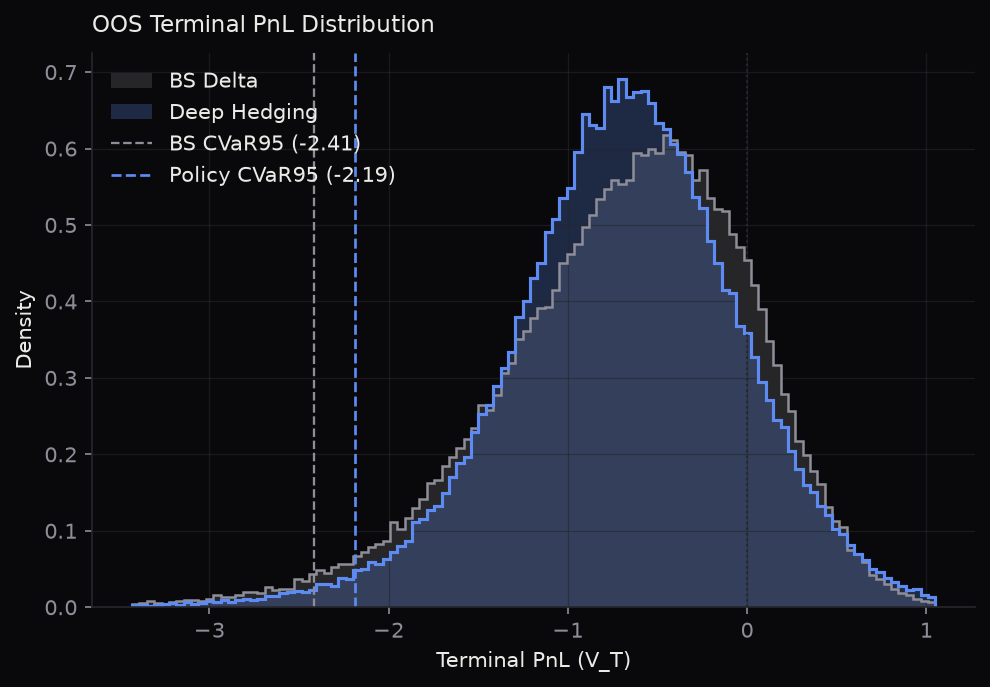
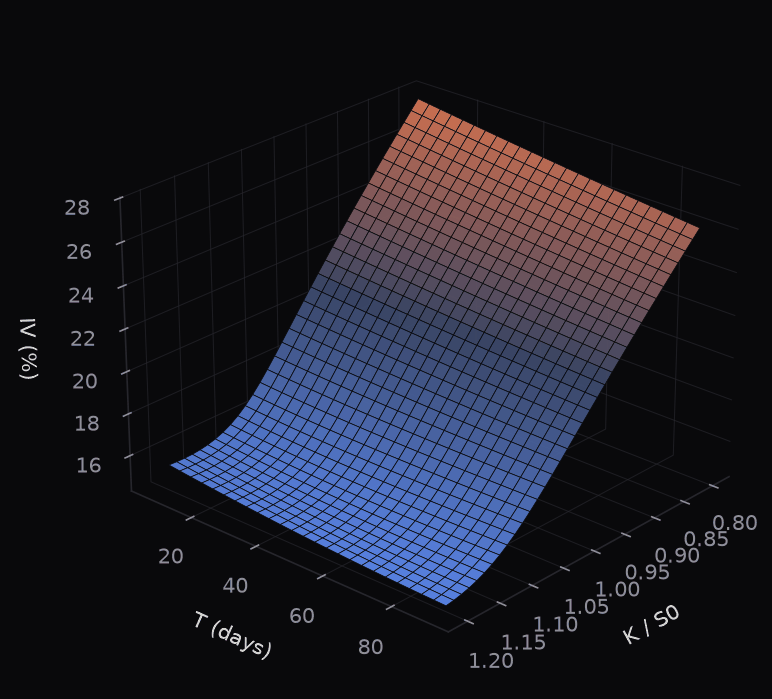

# cuda deep hedging

This project implements a neural network hedger in CUDA C++ based on Buehler et al. 2019. It trains a small network to hedge a 30-day at-the-money European call option under daily rebalancing and transaction costs, and compares it against Black-Scholes delta hedging on 100,000 simulated paths.

## Why

Black-Scholes assumes continuous, free trading and constant volatility. Once you rebalance once a day and pay proportional fees, chasing every spot move near the strike burns cash. Under stochastic volatility with negative return-variance correlation, plugging instantaneous volatility into the Black-Scholes delta also leaves tail risk unhedged. I built the simulator, neural network, portfolio accounting, backpropagation through time, and AdamW optimizer directly in CUDA to study both regimes at scale on a single laptop GPU.

## How it works

Each run generates 131,072 training paths, 32,768 validation paths, and 100,000 held-out test paths over 30 daily steps with `S0 = K = 100`, `r = 0.05`, and `T = 30/252`. The simulator supports standard geometric Brownian motion with `sigma = 0.20` and a Heston stochastic volatility model with `v0 = theta = 0.04`, `kappa = 2.0`, `xi = 0.50`, and `rho = -0.70`, stepped with 8 Full Truncation Euler substeps per day. For GBM the starting option price comes from the Black-Scholes formula; for Heston it is priced on a separate 200,000-path Monte Carlo draw, giving `3.0186` against the semi-analytical value of `3.0057`.

The policy is a two-layer MLP with 32 hidden units per layer that takes five inputs: normalized log-moneyness, prior delta, time remaining, instantaneous volatility, and strike slope context. At each of the 29 rebalancing steps, cash accrues at the risk-free rate and trades pay a proportional fee before final settlement at expiry. The network is trained with AdamW to minimize terminal PnL variance plus a `0.25` weight on smooth 95% CVaR so it learns to trade off variance against fee drag and left-tail losses.

On an RTX 3050 Laptop GPU with 4 GB VRAM, the full pipeline uses `134.0 MB` of device memory and trains at `168.89` to `181.88 ms` per epoch, or `20.90` to `22.51` million path-steps per second.

## Build and run

```bash
mkdir -p build && cd build
cmake ..
make -j
ctest --output-on-failure

./deep_hedger --model gbm --cost 0.0 --lambda 0.0 --wd 0.0 --lr 0.003
./deep_hedger --model gbm --cost 0.0025 --lambda 0.25 --wd 1e-4 --lr 0.003
./deep_hedger --model heston --cost 0.0025 --lambda 0.25 --wd 1e-4 --lr 0.003

cd .. && python scripts/analysis.py
```

Available flags: `--model`, `--train-paths`, `--val-paths`, `--test-paths`, `--cost`, `--lambda`, `--epochs`, `--lr`, `--wd`, `--seed`, `--loss`, and `--gamma`.

## Results

All numbers below come from 100,000 unseen test paths after 400 training epochs at `lr = 0.003`.

In frictionless GBM with `--lambda 0` and `--wd 0`, the network recovers the Black-Scholes delta surface with a mean absolute difference of `0.0159` and RMSE of `0.0251`. Once transaction costs are turned on from 10 to 50 bps, the policy cuts share turnover and beats Black-Scholes on both mean PnL and 95% CVaR.

| Cost bps | Strategy | Mean PnL | Std Dev | Variance | 95% CVaR | Turnover |
| :--- | :--- | ---: | ---: | ---: | ---: | ---: |
| 0 | BS Delta | 0.0033 | 0.4340 | 0.1883 | 1.0004 | 2.7448 |
| 0 | Deep Hedging | 0.0030 | 0.4514 | 0.2037 | 1.0376 | 2.7567 |
| 10 | BS Delta | -0.2749 | 0.4498 | 0.2023 | 1.3569 | 2.7448 |
| 10 | Deep Hedging | -0.2596 | 0.4686 | 0.2196 | 1.2431 | 2.5915 |
| 25 | BS Delta | -0.6923 | 0.4936 | 0.2436 | 1.9136 | 2.7448 |
| 25 | Deep Hedging | -0.6292 | 0.4843 | 0.2345 | 1.6455 | 2.4961 |
| 50 | BS Delta | -1.3879 | 0.6054 | 0.3665 | 2.8759 | 2.7448 |
| 50 | Deep Hedging | -1.2070 | 0.5073 | 0.2574 | 2.2754 | 2.3888 |

Under Heston dynamics, plug-in Black-Scholes leaves correlation risk unhedged even at 0 bps, where the network already lowers variance from `0.4851` to `0.4303`. Across 10, 25, and 50 bps, the learned policy beats plug-in Black-Scholes on variance, 95% CVaR, and mean PnL. At 25 bps, 95% VaR also improves from `-1.9486` to `-1.7716` and 99% CVaR drops from `3.1601` to `2.8699`.

| Cost bps | Strategy | Mean PnL | Std Dev | Variance | 95% CVaR | Turnover |
| :--- | :--- | ---: | ---: | ---: | ---: | ---: |
| 0 | Plug-in BS | 0.0125 | 0.6965 | 0.4851 | 1.6341 | 2.7827 |
| 0 | Deep Hedging | 0.0104 | 0.6560 | 0.4303 | 1.5669 | 2.7152 |
| 10 | Plug-in BS | -0.2697 | 0.6951 | 0.4831 | 1.9303 | 2.7827 |
| 10 | Deep Hedging | -0.2599 | 0.6623 | 0.4386 | 1.7848 | 2.6730 |
| 25 | Plug-in BS | -0.6929 | 0.7079 | 0.5011 | 2.4136 | 2.7827 |
| 25 | Deep Hedging | -0.6898 | 0.6455 | 0.4167 | 2.1875 | 2.7720 |
| 50 | Plug-in BS | -1.3983 | 0.7663 | 0.5871 | 3.2990 | 2.7827 |
| 50 | Deep Hedging | -1.3505 | 0.6149 | 0.3781 | 2.7933 | 2.6928 |

## Plots

### Delta adjustment surface


Policy delta minus plug-in Black-Scholes delta on the 25 bps Heston run. Above the strike the policy trims delta for negative skew, while just below the strike near expiry it holds position to avoid fee churn.

### Hedging surface


The learned policy surface in blue overlaid on the plug-in Black-Scholes surface in gray.

### Terminal PnL distribution


Out-of-sample PnL density on 100,000 Heston paths at 25 bps. The dashed lines mark 95% CVaR at `-2.19` for the network and `-2.41` for Black-Scholes.

### Friction frontier


95% CVaR loss and average share turnover across 0, 10, 25, and 50 bps for both GBM and Heston.

### Heston implied volatility surface


Implied volatility surface implied by our Heston parameters `rho = -0.70` and `xi = 0.50`, computed semi-analytically from the characteristic function. Implied volatility runs from `14.57%` on the upside wing to `27.77%` on the downside wing.
